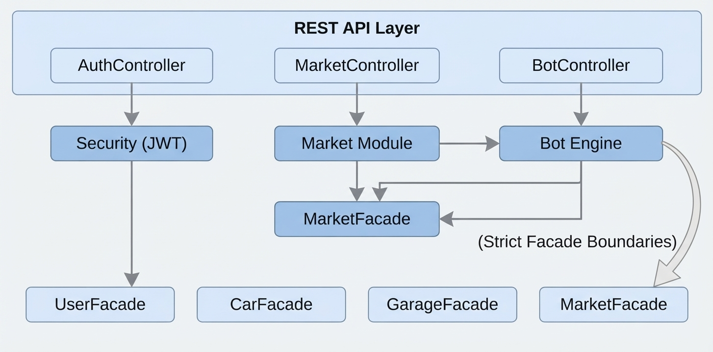
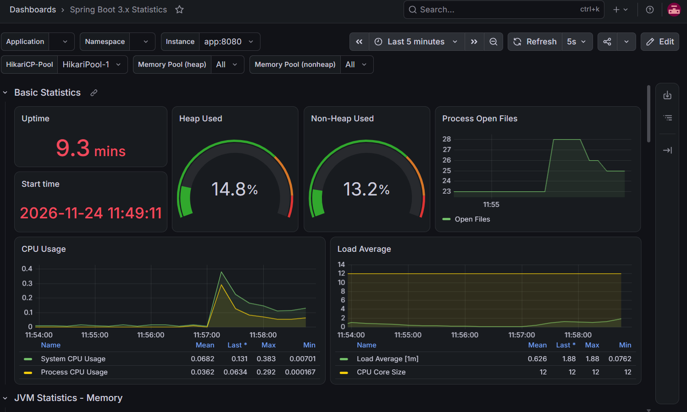
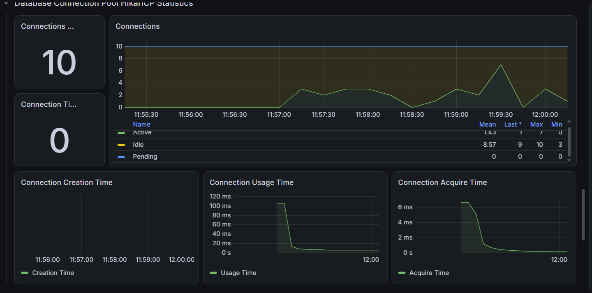
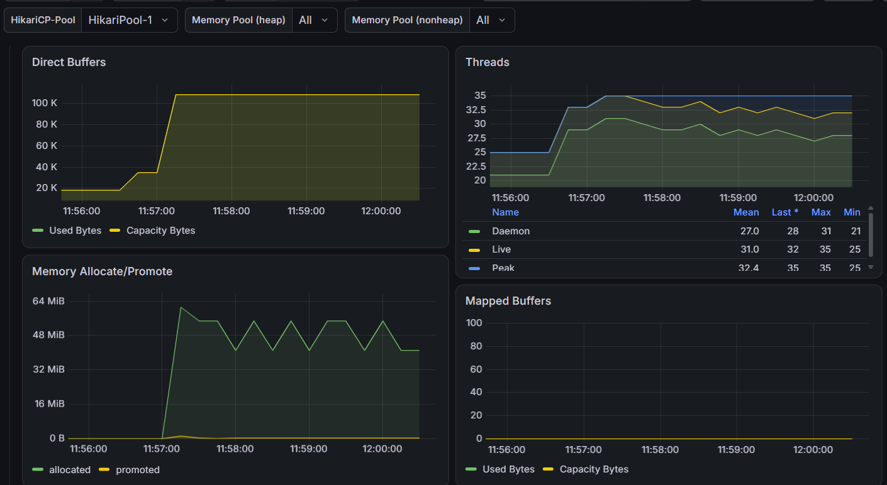

# Carbuyer — Car Market Simulator Backend

A concurrent modular monolith backend simulating an automated automotive marketplace where real users trade vehicles alongside autonomous market-maker bots.

Built with **Java 21 (Virtual Threads)**, **Spring Boot 3.3**, **PostgreSQL 16**, and **Flyway**, engineered around strict domain isolation, deadlock-free transactional execution, and tight container memory boundaries.

## Architecture

The system follows a **Modular Monolith** pattern. Domain contexts (`user`, `car`, `garage`, `market`) encapsulate their own entities, repositories, and services, exposing functionality strictly through explicit **Facade interfaces**. The `bot` simulation engine is an internal orchestrator with no outgoing facade—it interacts with the outside world solely via `BotController` and consumes domain facades.

<p align="center">
  <br/>
  <sub><b>Architecture:</b> Modular monolith request flow from REST controllers through domain modules and strict facade boundaries</sub>
</p>

## Key Engineering Decisions

### 1. Concurrency & Deadlock Prevention
* **Virtual Thread Bot Engine:** `BotService` manages concurrent market-maker workers via `Executors.newVirtualThreadPerTaskExecutor()` (with `spring.threads.virtual.enabled: true`), capping active workers at `50%` of the bot pool to prevent starvation and using `CountDownLatch` for responsive graceful shutdown.
* **Contention-Aware Queueing:** Custom `ConcurrentUniqueQueue<T>` (`LinkedHashSet` + `ReentrantLock`) tracks available buyers/sellers and `inFlightBots` without duplicate scheduling, dynamically rebalancing buyer/seller ratios (`30%` threshold to `50%` target).
* **Deterministic Lock Ordering:** During atomic car purchases (`MarketService.buyCar`), buyer and seller balances and garage slots are locked in ascending order of user ID (`Math.min(buyerId, sellerId)` to `Math.max(buyerId, sellerId)`) using `PESSIMISTIC_WRITE`. Random active listing selection for bots uses PostgreSQL `FOR UPDATE SKIP LOCKED` to avoid lock contention.

### 2. Database Integrity & Batch Performance (PostgreSQL 16 + Flyway)
* **Database-Level Invariants:** Enforced via `CHECK` constraints (`mileage >= 0`, `condition_score BETWEEN 0 AND 100`, `seller_id <> buyer_id`, status-dependent `closed_at`), foreign keys (`RESTRICT` / `CASCADE` / `SET NULL`), and optimistic locking (`@Version`).
* **Partial & Unique Indexes:**
  * `idx_market_listings_one_active_car` — enforces a single `ACTIVE` listing per car while preserving `SOLD` and `CANCELLED` history.
  * `idx_market_listings_feed` — partial index on `(created_at DESC) WHERE status = 'ACTIVE'` for paginated marketplace queries.
  * `idx_garage_slots_car_unique` — guarantees a car occupies at most one garage slot at any time.
* **Batching & Connection Tuning:** Bulk bot creation, vehicle generation, and slot allocation execute via `NamedParameterJdbcTemplate.batchUpdate` with `GeneratedKeyHolder`, paired with Hibernate `jdbc.batch_size: 50` (`order_inserts`, `order_updates`), `INCREMENT BY 50` database sequences, and a fixed-size HikariCP pool (`maximum-pool-size: 10`).

### 3. Security & Error Handling
* Stateless **JWT authentication** (access + refresh tokens) implemented via custom `OncePerRequestFilter` (`JwtAuthenticationFilter`) and `BCryptPasswordEncoder`.
* Role-based access control restricting bot lifecycle management (`/api/v1/bot/**`) to `ROLE_ADMIN`.
* Centralized exception translation (`@RestControllerAdvice`) returning standardized `ErrorResponse` payloads with HTTP status codes (`400`, `401`, `403`, `404`, `409`).

## Tech Stack

* **Language & Runtime:** Java 21 (Virtual Threads), Gradle (Kotlin DSL)
* **Framework:** Spring Boot 3.3.3 (Web, Data JPA, JDBC, Security, Validation, Actuator)
* **Database & Migrations:** PostgreSQL 16, Flyway, HikariCP
* **Auth & API Docs:** JJWT (`0.12.6`), Springdoc OpenAPI / Swagger UI (`2.6.0`)
* **Testing:** JUnit 5, Testcontainers (`postgres:16-alpine`), MockMvc, `TestRestTemplate`, Awaitility
* **Infrastructure:** Docker (multi-stage Alpine build), Docker Compose, GitHub Actions CI

## API Overview

Swagger UI is available at `/swagger-ui.html` (OpenAPI spec at `/v3/api-docs`).

| Method | Endpoint | Access | Description |
| :--- | :--- | :--- | :--- |
| `POST` | `/api/v1/auth/register` | Public | Register user, allocate initial balance & garage slot, issue JWT pair |
| `POST` | `/api/v1/auth/login` | Public | Authenticate credentials and return access/refresh tokens |
| `POST` | `/api/v1/auth/refresh` | Public | Issue a fresh JWT pair using a valid refresh token |
| `GET` | `/api/v1/market/listings` | Authenticated | Paginated feed of `ACTIVE` listings (`max-page-size: 10`) |
| `POST` | `/api/v1/market/listings` | Authenticated | List an owned vehicle for sale |
| `POST` | `/api/v1/market/listings/{id}/buy` | Authenticated | Atomically purchase a car (transfers funds, ownership, and garage slot) |
| `POST` | `/api/v1/market/listings/{id}/cancel` | Authenticated | Cancel an active listing owned by the requester |
| `POST` | `/api/v1/bot/start/{amount}` | `ROLE_ADMIN` | Sync bot pool in DB and launch virtual-thread workers (`1..999`) |
| `POST` | `/api/v1/bot/stop` | `ROLE_ADMIN` | Gracefully stop all active simulation workers |
| `GET` | `/actuator/{health,info,metrics}` | Public | Application health, build info, and runtime metrics |

## Getting Started

### Prerequisites
* JDK 21+
* Docker & Docker Compose

### Run with Docker Compose
The `docker-compose.yml` is tuned for low-memory environments (`650MB` container limit / `-Xmx450m -Xms256m` for the application, `300MB` for PostgreSQL):

```bash
docker compose up --build -d
```

The API will be available at `http://localhost:8080` and Swagger UI at `http://localhost:8080/swagger-ui.html`.

### Local Development & Environment Variables

| Variable | Default | Description |
| :--- | :--- | :--- |
| `DB_HOST` | `localhost` | PostgreSQL host |
| `DB_PORT` | `5432` | PostgreSQL port |
| `DB_NAME` | `carbuyer_db` | Database name |
| `DB_USER` | `postgres` | Database username |
| `DB_PASSWORD` | `postgres` | Database password |
| `JWT_SECRET` | *(dev fallback)* | 256-bit HMAC secret key for signing JWTs |
| `SHOW_SQL_LEVEL` | `OFF` | Hibernate SQL logging level (`DEBUG` / `OFF`) |

Run locally with Gradle:

```bash
./gradlew bootRun
```

## Testing & CI

Integration and slice tests run against a real **PostgreSQL 16** instance managed by **Testcontainers** (`postgres:16-alpine`):
* **Repository Slice Tests (`@DataJpaTest`):** Verify DB `CHECK` constraints, partial unique indexes, foreign key cascade/restrict rules, pessimistic locks, and custom queries.
* **Controller & Security Tests (`@SpringBootTest` + `MockMvc` / `TestRestTemplate`):** Verify JWT authentication flows, `ROLE_ADMIN` authorization, request validation, and error payloads.
* **Concurrency Simulation Tests (`BotServiceIT`):** Validate dynamic bot pool scaling (`500`–`1500` bots) running concurrently alongside real user transactions.

Run the full verification suite:

```bash
./gradlew check
```

Every push and pull request targeting `main` or `develop` runs the automated **GitHub Actions** pipeline (`Carbuyer CI with Gradle`).

## Observability & Load Testing

The application exposes runtime and connection pool metrics via **Spring Boot Actuator** and **Micrometer** (`/actuator/prometheus`), scraped by **Prometheus** (`5s` interval) and visualized in **Grafana** (Dashboard ID `19004`).

### Benchmark Setup & Results
Tested with **1,000 autonomous bots** (`500` buyers / `500` sellers) executing concurrently across **500 virtual-thread workers** inside a `650MB` container (`-Xmx450m -Xms256m`) against a `10`-connection HikariCP pool:

* **DB Transaction Duration (`Connection Usage Time`):** drops from `~105 ms` cold-start peak to `~8–10 ms` steady-state post-JIT warmup
* **Connection Pool Contention (`HikariCP`):** `0` pending threads and `0` connection timeouts (`1.43` mean / `7` max active connections out of `10`, `< 0.5 ms` steady-state acquire time)
* **Memory Footprint:** `14.8%` (`~66.6 MB`) of `450 MB` heap cap; `0 B` promoted to Old Gen under sustained load (no memory leaks)
* **OS Thread Overhead & CPU:** `32` live (`35` peak) platform carrier threads backing `500` virtual workers at `3.6%` mean / `6.3%` steady-state process CPU usage (`29.2%` startup peak)

<p align="center">
  <br/>
  <sub><b>Overview:</b> Heap usage (14.8%), Non-Heap (13.2%), and Process CPU profile during JIT warmup and steady-state load</sub>
</p>

<p align="center">
  <br/>
  <sub><b>HikariCP Pool:</b> Zero pending threads, 0 timeouts, 1.43 mean active connections (max 7/10), and ~8–10 ms steady-state transaction usage time</sub>
</p>

<p align="center">
  <br/>
  <sub><b>Threads & Memory:</b> 32 live (35 peak) OS carrier threads backing 500 virtual workers with 0 B sustained Old Gen promotion</sub>
</p>